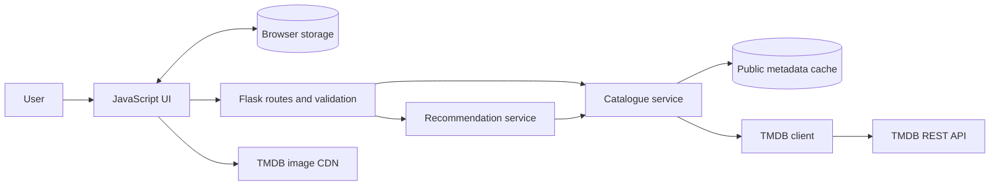
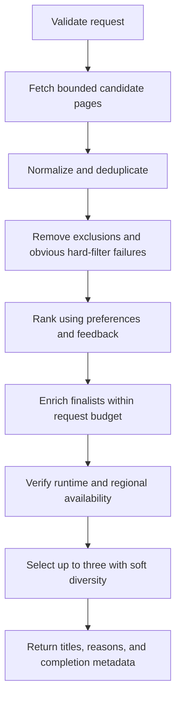

# SceneQuest — personal project system design

## 1. Scope and assumptions

SceneQuest uses Python, Flask, JavaScript, and TMDB to help users discover movies and TV shows, receive up to three personalized recommendations, and keep preferences, a watchlist, and viewing history without signing in.

This is a personal, noncommercial project. The MVP is one Flask application serving HTML/CSS/JavaScript and a JSON API on the same origin. Personal records persist in the browser. Flask processes submitted recommendation inputs but does not persist them. TMDB credentials remain on the server. Use a small in-memory public metadata cache and basic application logs. TMDB's developer API permits free noncommercial use with its required attribution; provider data also requires JustWatch attribution.

Browser data is specific to an origin and browser profile. Private browsing, clearing site data, storage failures, or changing devices can remove or make it unavailable. Export/import is a later enhancement. Accounts, a database, cross-device sync, Redis, multiple instances, and advanced analytics are also deferred.

## 2. Functional requirements

| Capability | Required behavior |
|---|---|
| Discovery | Browse movies or TV in separate tabs with genre, provider, rating, year, original-language, and runtime filters. |
| Title search | Search a title within the selected movie or TV tab; advanced discovery filters belong to the discovery flow. |
| Details | Display synopsis, poster, genres, first release/air date, rating with vote count, runtime when known, and regional provider information. |
| Preferences | Save preferred genres, media choice, display language, original-language preference, country, and providers. |
| Recommendations | Return three distinct eligible titles when the bounded candidate search finds enough; support movies, TV, or both. |
| Explanations | Explain actual preference matches without presenting a score as a probability of enjoyment. |
| Watchlist | Add/remove titles and optionally allow watchlisted titles in recommendations. |
| History and feedback | Mark watched, liked, disliked, or not interested. Watched alone is not positive feedback. |
| Persistence | Restore personal state, handle malformed storage and write failures, and support clearing personal data. |
| Empty and failure states | Distinguish too few candidates, no candidates found, partial upstream failure, unavailable upstream, and stale display data. |

Hard filters express eligibility. Soft preferences influence ordering. Preferred genres must not silently become hard genre constraints. Watched and dismissed titles are excluded; watchlisted titles are excluded by default with an explicit toggle to include them.

## 3. Nonfunctional requirements

These requirements focus on a responsive, reliable personal application. Record timings during development; performance measurements are observations rather than service-level promises.

| Area | Initial requirement |
|---|---|
| Performance | Show loading states, debounce title search by about 300 ms, cancel obsolete browser requests, and reuse cached metadata. |
| Request duration | Use an 8-second server work budget for requests that call TMDB; return verified partial results when work cannot finish. |
| Reliability | Personal-list edits continue during upstream outages; details can display marked stale cached data. |
| Security | HTTPS for the publicly hosted demo, server-held credentials, schema validation, allowlisted upstream routes, safe DOM rendering, public API rate limits. Local development may use HTTP on localhost. |
| Privacy | Do not persist or log recommendation bodies. Personalized responses use `Cache-Control: no-store`. |
| Accessibility | Keyboard operation, labelled controls, visible focus, accessible status updates, readable contrast, responsive layouts. |
| Deployment scope | One application instance with an in-memory cache; shared infrastructure is a future option. |
| Maintainability | Separate routes, validation, TMDB adapter, normalization, cache, and ranking logic. Version public contracts and browser schemas. |
| Diagnostics | Basic logs for request IDs, durations, upstream failures, and candidate counts without personal records. |

## 4. High level architecture



The cache and TMDB client are both owned by the catalogue service: a cache miss triggers an upstream request. The frontend calls same-origin Flask APIs. Images load directly from TMDB's image CDN. Flask returns normalized data, never its TMDB token.

Suggested modules:

```text
app/
  __init__.py             # application factory
  routes/                # JSON API routes
  schemas.py             # input/output validation
  services/catalogue.py  # discovery, search, details
  services/recommendations.py
  tmdb/client.py         # credentials, timeouts, retries
  tmdb/normalize.py      # unified movie/TV representation
  cache.py
  templates/index.html
  static/js/api.js
  static/js/storage.js
  static/js/profile.js
  static/js/ui.js
  static/css/styles.css
tests/
```

## 5. Data models and storage

### Title identity and normalization

Use `(media_type, tmdb_id)` everywhere; derive a key such as `movie:123` or `tv:123`. Movie and TV IDs must not collide in lists, exclusions, or caches.

Normalize TMDB's `title`/`name` and `release_date`/`first_air_date` into a common shape:

```json
{
  "key": "movie:123",
  "media_type": "movie",
  "tmdb_id": 123,
  "title": "Example title",
  "overview": "Example synopsis",
  "poster_path": null,
  "first_release_date": "2020-01-01",
  "original_language": "en",
  "genre_keys": ["drama", "mystery"],
  "rating": {"average": 7.5, "votes": 1200},
  "runtime": {"minutes": null, "basis": "movie"},
  "metadata_checked_at": "2026-10-06T00:00:00Z"
}
```

Null means unknown, not zero. List responses can omit enrichment fields. Detail responses add runtime and availability with their own timestamps.

### Genre mapping

Fetch separate movie and TV genre lists. Expose application genre keys with explicit mappings for each media type. Shared categories such as drama and mystery can map directly. Broad categories such as `action_adventure` must use clear labels and documented movie/TV mappings. Do not pretend every genre has an exact counterpart. Reject an unsupported hard genre/media combination with `422`.

### Browser state

Persist one versioned document under `scenequest.state`:

```json
{
  "schema_version": 1,
  "preferences": {
    "region": "MY",
    "display_language": "en-US",
    "media_choice": "both",
    "preferred_genres": ["mystery"],
    "preferred_original_languages": ["en"],
    "provider_ids": {"movie": [], "tv": []}
  },
  "watchlist": [],
  "history": [],
  "dismissed": []
}
```

Each personal entry contains its composite key, action timestamp, and a small metadata snapshot: title, poster path, genre keys, original language, and snapshot timestamp. History additionally stores `sentiment` as `liked`, `disliked`, or `neutral`.

The implemented entry fields are `key`, `action_at`, and `snapshot`; snapshot fields are `title`, `poster_path`, `genre_keys`, `original_language`, and `snapshot_at`. Provider preferences are separate for movies and TV and are reset when the user changes country. The initial supported countries are MY, US, and GB, with en-US display text.

Snapshots let lists render during outages and avoid fetching every item individually. Refresh visible items lazily through the backend and label stale availability. Never persist full upstream responses or secrets in browser storage.

Validate stored JSON and its schema version. Preserve incompatible or malformed data rather than silently overwriting it, and show a reset option. Handle quota or disabled-storage errors with an explicit persistence warning and an in-memory fallback. Migration tooling, export/import, and robust synchronization across tabs are future enhancements; simultaneous tab writes may overwrite one another in the MVP.

## 6. Public API contracts

All endpoints use `/api/v1`. Catalogue GET responses may be cached. Recommendation POST responses must not be cached.

| Method and endpoint | Contract |
|---|---|
| `GET /config?display_language=en-US` | Return genre mappings, supported countries/languages, defaults, and limits. |
| `GET /providers?media_type=movie&region=MY` | Return provider choices for that media type and country. |
| `GET /search?q=arrival&media_type=movie&page=1` | Title search within one media type; returns TMDB search pagination. |
| `GET /discover?media_type=movie&genre_keys=mystery&region=MY&provider_ids=8&access_type=flatrate&rating_min=7&year_from=2015&original_language=en&runtime_max=150&page=1` | Discovery within one media type. |
| `GET /titles/movie/123?region=MY&display_language=en-US` | Normalized detail and regional availability. |
| `POST /titles/batch` | Refresh up to 20 composite title IDs; return successes and per-item errors. Public metadata only. |
| `POST /recommendations` | Apply hard constraints, rank eligible candidates, and return up to three verified titles. |

Search and discovery do not accept `media_type=both`; recommendation does. This avoids undefined combined-catalogue pagination. Hard genre and provider arrays mean **match any selected value**, documented in the API. Rating range is 0–10; years are inclusive. `display_language` controls translated text; `original_language` restricts the title's original language.

For discovery filters requiring local verification, such as runtime, `page` identifies the upstream candidate page. Return `source_page`, `has_more_source_pages`, and `verification_complete`; pages may contain fewer than 20 eligible titles. Do not expose TMDB's unfiltered total as an exact eligible total. A future cursor can support fuller app-filtered pages.

### Recommendation request

```json
{
  "filters": {
    "media_type": "both",
    "region": "MY",
    "provider_ids": [8],
    "access_type": "flatrate",
    "rating_min": 7,
    "year_from": 2015,
    "original_language": "en",
    "runtime_max": {"movie": 150, "tv_episode": 60}
  },
  "preferences": {
    "preferred_genres": ["mystery", "drama"],
    "preferred_original_languages": ["en"]
  },
  "taste_profile": {
    "algorithm_version": 1,
    "genre_affinity": {"mystery": 0.8, "drama": 0.3},
    "language_affinity": {"en": 0.5},
    "feedback_count": 8
  },
  "exclude": [
    {"media_type": "movie", "tmdb_id": 123}
  ]
}
```

The frontend builds the taste profile from explicit likes/dislikes and metadata snapshots. It aggregates the feedback into bounded genre/language weights, so the backend does not need to hydrate every historical title. Neutral watched items affect exclusions only. Validate all affinity values in `[-1, 1]`. Client profile features are user-supplied preferences, never evidence that a candidate meets a hard constraint.

Limit requests to 64 KiB, exclusions to 1,000 unique titles, and provider choices to 10. Reject excess with `413` or `422`; never silently truncate exclusions. If personal lists grow beyond this, revise the protocol before expanding the supported limit.

### Recommendation response

```json
{
  "result_status": "limited",
  "retrieval_status": "completed",
  "shortlist": [
    {
      "key": "movie:456",
      "media_type": "movie",
      "tmdb_id": 456,
      "title": "Example title",
      "reasons": ["Matches your mystery preference"],
      "availability": {
        "region": "MY",
        "access_type": "flatrate",
        "provider_ids": [8],
        "checked_at": "2026-10-06T00:00:00Z"
      }
    }
  ],
  "search_complete": true,
  "candidate_limit_reached": false,
  "warnings": [],
  "request_id": "example-request-id"
}
```

This example contains one eligible title, so its result is `limited`. `result_status` is `full` for three titles, `limited` for one or two, and `empty` for zero. Independently, `retrieval_status` is `completed` when planned work finishes or the intentional early-stop condition is met, `partial` when some work fails or is skipped due to a deadline/call budget, and `failed` when no useful upstream candidate data can be obtained. A full shortlist can therefore have partial retrieval.

`search_complete` is true only for completed bounded retrieval; it never claims the entire catalogue was searched. `candidate_limit_reached` is true when the configured candidate or enrichment ceiling leaves additional work unexamined. Return `503` if upstream failure leaves no verified titles; otherwise useful partial results return `200`. A completed empty search returns `200` with `result_status=empty`. API errors also include the relevant retrieval status when applicable.

Errors use `{ "error": { "code": "INVALID_FILTER", "message": "...", "fields": {} }, "request_id": "..." }`. Use `400` for malformed JSON, `422` for invalid fields, `404` for missing titles, `413` for oversized requests, `429` for the app's limiter, `502` for unusable upstream responses, and `503` for unavailable upstream service.

## 7. TMDB integration and filtering

| SceneQuest input | TMDB translation |
|---|---|
| Movie discovery | `/3/discover/movie` |
| TV discovery | `/3/discover/tv` |
| Title search | `/3/search/movie` or `/3/search/tv` |
| Genre keys | Media-specific IDs in `with_genres`; use OR semantics for multiple selections. |
| Provider/country | `with_watch_providers`, `watch_region`, `with_watch_monetization_types` |
| Rating | `vote_average.gte` |
| Movie year range | `primary_release_date.gte/lte` |
| TV year range | `first_air_date.gte/lte` |
| Original language | `with_original_language` |
| Movie runtime | `with_runtime.gte/lte`, followed by detail verification where required |
| Title details | `/3/movie/{id}` or `/3/tv/{id}` |
| Availability | Corresponding `/watch/providers` endpoint, selecting the requested country |

Set adult exclusion explicitly. Preserve upstream field names only inside the adapter. Fetch provider lists separately for movies and TV, and refresh selections when country/media changes. Treat subscription, free, ads, rent, and buy as separate access modes; subscription is the MVP default.

For TV, define representative episode runtime as the median of valid positive `episode_run_time` values in series details. If unavailable, display unknown. This is not a guarantee about each episode. Enforce the app's TV runtime rule after fetching details, rather than assuming upstream runtime filtering uses the same aggregation. Unknown runtime fails an active hard runtime constraint. Unknown first-release date likewise fails an active year constraint.

Verify provider constraints for shortlisted titles against the most recent nonexpired regional availability cache entry. Cached data is still only TMDB's reported availability; show the checked timestamp and link users to the provided TMDB watch page. Do not invent direct provider playback URLs.

## 8. Recommendation deep dive



### Candidate generation and call budget

Fetch at most two candidate pages per requested media type: at most four calls for `both`. The first query uses the user's hard filters plus up to two preferred genre categories, with OR semantics. If explicit genre preferences are absent, use the two highest positive feedback affinities. The second query uses hard filters alone, providing broader candidates. Both use a stable supported sort such as `popularity.desc`.

When a hard genre filter is also active, narrow the first query to categories compatible with that constraint; if none are compatible, fetch two successive pages of the hard-filter query instead. If no applicable taste signal exists, likewise use pages 1 and 2 of the hard-filter query. Deduplicate the combined results. This retrieves relevant candidates before ranking while keeping every hard constraint. The limited sample cannot guarantee the globally best result.

Rank available candidates, then enrich at most 12 finalists. Details and provider availability can use supported `append_to_response` behavior; otherwise use separate calls. Stop early once six eligible finalists are verified, providing a small pool for diversity selection, or when candidates are exhausted. Apply the shared request-control rules below. Cache hits do not consume upstream HTTP attempts.

### Taste profile

Use only explicit likes/dislikes to compute inferred preferences. For genre `g`, let `likes_g` and `dislikes_g` count distinct titles with the latest positive or negative feedback containing that genre. Define `affinity_g = (likes_g - dislikes_g) / (likes_g + dislikes_g + 2)`. Compute language affinity identically. The smoothing term of 2 prevents a single action from creating an extreme preference. Neutral watched entries contribute nothing; missing snapshot features are skipped. `feedback_count` counts valid rated entries used, and `algorithm_version=1` identifies these rules. Age decay is deferred.

### Scoring

Normalize components to `[0, 1]` and start with:

```text
score = 0.45 * explicit_preference_match
      + 0.35 * inferred_preference_match
      + 0.20 * rating_confidence
```

For explicit genre preference set `P` and candidate genre set `G`, genre match is `|P intersection G| / |P|`. Language match is 1 when the candidate's original language is preferred and 0 otherwise. Combine active explicit genre/language components with weights 0.8 and 0.2, renormalizing when either preference is absent. A missing candidate feature scores 0 for an active preference.

For inferred genre match, take the mean affinity across candidate genres, treating an unrecorded genre as 0, then map it into `[0,1]` using `(mean + 1) / 2`. Inferred language match is `(language_affinity + 1) / 2`, with unrecorded languages likewise neutral. Combine with weights 0.8 and 0.2, using only feature dimensions for which the profile has recorded feedback. Missing candidate features are neutral. Omit the entire inferred component when there is no usable feedback.

Rating confidence is `((v * R + m * C) / (v + m)) / 10`, where `R` is the title's rating and `v` is its vote count. Use initial documented constants `C=6.0` and `m=100` for both media types. A missing rating or zero votes uses the prior. These are simple tuning defaults, not calibrated population statistics. Clamp outputs to `[0,1]`. Statistical calibration and per-media priors are future improvements.

Redistribute weights among available components by dividing each active weight by their sum. For a cold start with neither preferences nor feedback, rank by rating confidence. Resolve exact ties by composite title key for reproducibility. Provider constraints affect eligibility rather than adding a constant ranking bonus. Freshness does not influence ranking unless implemented as an explicit preference later.

### Shortlist and explanations

Select distinct composite keys from the verified pool. Pick the highest score first, then subtract a diversity penalty of `0.05 * maximum genre Jaccard similarity` to already selected titles for each subsequent pick. Empty genre sets incur no penalty. For `both`, add a selection bonus of 0.03 to an as-yet-unrepresented media type. Resolve ties by composite key. These small adjustments preserve hard eligibility and provide deterministic soft diversity. Franchise deduplication is postponed until suitable metadata is implemented.

Reasons come from measured features: explicit genre match, positive feedback overlap, or verified regional provider data. Never claim a title matches provider/runtime constraints before verification. Keep internal scores out of the UI.

When fewer than three are found, say: "We found two matches in this search." Offer specific filter adjustments for the user to apply; never relax constraints automatically or claim no qualifying titles exist anywhere.

## 9. Cache, reliability, and request control

Initial cache TTLs: configuration/genres 24 hours, provider choices 24 hours, search/discovery 10 minutes, title details 24 hours, regional availability 6 hours. These are adjustable defaults, not upstream freshness guarantees.

Cache keys include endpoint, media type, title ID where applicable, all normalized filters, page/sort, country, and display language. Personal profiles and recommendation results are excluded from shared caches. Stale public metadata may be used for labelled display during outages; expired availability/runtime verification must not silently pass active shortlist constraints.

Use connection pooling and a monotonic 8-second work deadline. Start with a 2-second connection timeout and a 4-second read timeout, shortening both to fit the remaining budget. Stop scheduling calls as the deadline approaches. Bound running calls with their own timeouts; do not assume cancelling a future aborts an HTTP request. Avoid executor shutdown behavior that waits indefinitely for outstanding work. The deadline is a work-control target rather than a strict end-to-end response guarantee.

Retry idempotent GETs at most once for transient errors when time and attempt budgets allow. Count every retry as another upstream HTTP attempt. Respect upstream `429` and `Retry-After` when present; return partial/error results if waiting would exceed the deadline.

| Request class | Work ceiling | Upstream HTTP attempt ceiling |
|---|---|---|
| Recommendations | Up to four candidate pages and 12 enriched finalists | 28, including retries |
| Discovery | One source page and up to 20 title detail verifications when required | 41, including retries |
| Batch refresh | Up to 20 unique title identities | 40, including retries |
| Single details | One title and its regional providers | 4, including retries |
| Search/configuration/provider choices | Only the upstream calls needed by the route | 8, including retries |

Use an upstream concurrency ceiling of four across this single application process. All classes share the work deadline. When a ceiling prevents verification, omit unverified titles from constrained results and mark incomplete work explicitly. Batch responses include per-item failures; discovery returns `verification_complete=false` and a warning. Cache hits do not consume attempts. These ceilings allow bounded retries without requiring the app to spend the entire budget.

When exposing the demo publicly, add a basic per-IP limit starting at 60 catalogue requests/minute and 10 recommendation requests/minute. Local development can disable this limiter. Configure forwarded IP handling only for the known hosting proxy. Shared distributed rate limiting is deferred.

## 10. Security, privacy, and attribution

Serve UI and API on one origin. Use HTTPS for the publicly hosted demo; local development may use HTTP on localhost. Store `TMDB_ACCESS_TOKEN` in environment configuration, exclude local secrets from source control, and never expose it in errors or JavaScript. Allowlist upstream methods and paths so users cannot supply arbitrary URLs. Render external text safely, validate stored JSON and request bodies, and enforce all request limits.

Cache public metadata according to the described policy; personalized responses use `no-store`. Basic logs exclude preference bodies, watchlists, feedback, and secrets. Explain that submitted taste profiles are processed on the server while personal records persist in the browser. Clearing data resets browser records and preferences.

Include TMDB's approved logo and required notice in About/Credits: "This product uses the TMDB API but is not endorsed or certified by TMDB." Attribute watch-provider data to JustWatch. Display regional availability as reported data rather than a playback guarantee.

## 11. Deployment and growth

Run locally with Flask's development server. For a publicly hosted demo, deploy one application instance using a production WSGI server and the hosting platform's HTTPS support. Use an in-memory public-data cache; cache loss after restart is acceptable. Bounded direct upstream calls provide a fallback if caching is unavailable.

A simple `/health` endpoint can support the hosting platform; it checks the local application without calling TMDB. Add Redis, multiple workers/instances, elaborate health probes, and metrics dashboards only when usage creates a concrete need. Accounts and cross-device sync would introduce authenticated APIs and a durable database in a later design.

## 12. Verification and delivery order

Use focused tests for composite-ID collisions, movie/TV genre mappings, year bounds, unknown runtime, country/access-type providers, exclusions, score calculations, negative/neutral feedback, cold starts, and deterministic shortlist selection. Test preferred-genre candidate retrieval and the independent result/retrieval statuses. Stub the TMDB adapter for timeout, retry-budget, and partial-failure cases. Verify malformed browser storage, write failures, clearing data, and personal-list editing during an outage. A small live integration smoke test checks endpoint compatibility.

Record representative cold/warm request durations during development to spot slow behavior. Confirm API credentials do not appear in frontend assets or error responses. Verify shortlist titles satisfy active constraints and incomplete searches are labelled. Sustained load tests and strict performance targets are deferred.

Build in order: adapter/normalizer and configuration; search/discovery/details; browser state and personal lists; taste profile and recommendation service; timeouts/caching/attribution; accessibility and optional public-demo deployment. Later enhancements include export/import, migrations, robust tab synchronization, accounts/sync, advanced recommendations, and infrastructure driven by actual usage.

## 13. Primary references

- [TMDB movie discovery](https://developer.themoviedb.org/reference/discover-movie)
- [TMDB TV discovery](https://developer.themoviedb.org/reference/discover-tv)
- [Movie genres](https://developer.themoviedb.org/reference/genre-movie-list) and [TV genres](https://developer.themoviedb.org/reference/genre-tv-list)
- [Search and details](https://developer.themoviedb.org/docs/search-and-query-for-details)
- [TV details](https://developer.themoviedb.org/reference/tv-series-details)
- [Append to response](https://developer.themoviedb.org/docs/append-to-response)
- [Regional provider data and JustWatch attribution](https://developer.themoviedb.org/reference/tv-series-watch-providers)
- [Image configuration](https://developer.themoviedb.org/docs/image-basics)
- [Rate limiting](https://developer.themoviedb.org/docs/rate-limiting)
- [TMDB attribution](https://developer.themoviedb.org/docs/faq)
